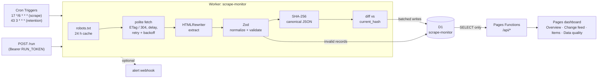

# cf-scrape-monitor
 
A scheduled Cloudflare Worker scrapes a small set of public pages, validates what it extracts
against strict schemas, saves a new snapshot only when the data has changed, and serves a
dashboard showing what changed and when.
 
This is the cloud version of `polite-scraper`: the same
fetch → extract → normalize → validate → store → report pipeline, but on a schedule and with history.
 
- **Dashboard:** https://scrape-monitor-dashboard.pages.dev
- **Scraper:** https://scrape-monitor.scrape-monitor-worker.workers.dev (only `POST /run` with a token does anything)
## Architecture
 

 
## Status
 
| # | Milestone | Status | Evidence |
|---|---|---|---|
| 0 | Setup | ☑ | D1 `scrape-monitor` created; migrations applied locally and remotely |
| 1 | Single target, local | ☑ | `wrangler dev --test-scheduled` + `/__scheduled` wrote 60 books to local D1 |
| 2 | Validation | ☑ | strict Zod schemas; `test/fixtures/books-broken.html` → 3 rows in `validation_errors` |
| 3 | Change detection | ☑ | unchanged second run: 0 snapshots; modified fixture: one `changes` row per field |
| 4 | Politeness | ☑ | robots.txt, conditional requests, per-host delay, retry/backoff + `Retry-After`, User-Agent |
| 5 | Deploy scraper | ☑ | deployed with cron; first remote run stored 60 books |
| 6 | Dashboard API | ☑ | Pages Functions bound to the same D1, JSON + `Cache-Control: max-age=60` |
| 7 | Dashboard UI | ☑ | overview, change feed, item history chart, data-quality view |
| 8 | Second target + hardening | ☑ | quotes target, per-target isolation, retention cron, webhook alerting |
| 9 | Docs | ☑ | this README |
 
All of the above is covered by 58 tests (`npm test`).
 
## Target classification
 
### books.toscrape.com
 
- **Site:** https://books.toscrape.com, a public sandbox built for practising scraping
  (see https://toscrape.com).
- **Why:** prices and stock are exactly the kind of data a change monitor tracks, and the site
  exists so people can practise on it.
- **Scope:** the first 3 catalogue pages only (60 books). No per-book detail pages.
- **Data collected:** title, product URL, price, availability (in stock yes/no), star rating
  (1–5), plus provenance (source page). Item key: product URL.
- **robots.txt check:** requested `https://books.toscrape.com/robots.txt` on 2026-11-11 and
  got `404`, so no robots file was found. The Worker re-checks it every 24 h and obeys it if
  one appears.
- **Why this is appropriate:** it's a practice site that invites scraping, we read 3 pages
  at most every 6 hours using conditional requests, and no personal data is involved.
### quotes.toscrape.com
 
- **Site:** https://quotes.toscrape.com, a sister sandbox from the same project.
- **Why:** a second, differently shaped target (lists of tags, no per-item URL) shows the
  per-target modules and isolation working.
- **Scope:** the first page only (10 quotes).
- **Data collected:** quote text, author name, tags (lowercased, sorted), plus provenance.
  Item key: `author: text`.
- **robots.txt check:** requested `https://quotes.toscrape.com/robots.txt` on 2026-11-11 and
  got `404`, so no robots file was found. It's re-checked every 24 h.
- **Why this is appropriate:** same reasons as above. Author names are those of famous
  published authors, not personal data about users.
## Repository layout
 
```text
cf-scrape-monitor/
  worker/                  # scraper (cron + POST /run)
    src/index.ts           # scheduled() dispatch on event.cron, POST /run
    src/pipeline.ts        # fetch → parse → validate → hash → persist, per-target try/catch
    src/fetcher.ts         # robots.txt, conditional requests, delay, timeout, retry/backoff
    src/robots.ts          # robots.txt matcher (RFC 9309 longest-match)
    src/persist.ts         # diff against items.current_hash, batched D1 writes
    src/hash.ts            # canonical JSON, SHA-256, field diffs
    src/schemas.ts         # Zod schemas (Book, Quote)
    src/targets/           # one module per target: urls, HTMLRewriter extractor, schema, key
    src/retention.ts       # 90-day snapshot retention
    src/alert.ts           # optional webhook alert
    scripts/seed-demo.mjs  # fills the LOCAL D1 with a demo week of history
    wrangler.toml
  dashboard/               # Pages project
    public/                # index.html, changes.html, item.html, quality.html, about.html, app.js, styles.css
    functions/api/         # summary, runs, changes, items, items/[id]/history, errors, targets
    lib/http.ts            # shared JSON / param helpers
    wrangler.toml
  migrations/              # D1 migrations (shared by both)
  test/                    # Vitest (runs inside workerd) + HTML fixtures
  docs/screenshots/
```
 
## Setup
 
Requires Node 22+ and a Cloudflare account. It's an npm workspace, so install once at the root:
 
```powershell
npm install
cd worker
npx wrangler login
npx wrangler d1 create scrape-monitor        # paste database_id into worker/ and dashboard/ wrangler.toml
npm run db:migrate:local
npm run db:migrate:remote
```
 
Local secrets live in `worker/.dev.vars` (gitignored):
 
```
RUN_TOKEN=<random string>
REQUEST_DELAY_MS=1500
```
 
## Run locally
 
```powershell
# scraper
cd worker
npm run dev:scheduled
curl.exe "http://localhost:8787/__scheduled?cron=17+*/6+*+*+*"     # one real scrape into local D1
 
# optional: a week of demo history for the dashboard (local only: wipes local data)
node scripts/seed-demo.mjs > .wrangler/demo.sql
npx wrangler d1 execute scrape-monitor --local --file .wrangler/demo.sql
 
# dashboard (shares the scraper's local D1 state)
cd ../dashboard
npm run dev        # http://localhost:8788
```
 
## Tests
 
```powershell
npm test           # from the repo root
npm run typecheck
```
 
Tests run inside the Workers runtime with `@cloudflare/vitest-plugin`, against a fresh local D1
with all migrations applied. `fetch` is injected, so no test touches the network:
 
- **Unit:** extractors against saved HTML in `test/fixtures/`, Zod schemas (good and bad
  records), canonical hashing, field diffs, robots.txt matching.
- **Integration:** row counts in `runs`, `items`, `snapshots`, `changes` over two runs, one
  with a modified fixture.
- **Failure cases:** 500 (retried once), 503 then 200, 429 + `Retry-After`, timeout, 304,
  malformed HTML (0 records), robots.txt disallow, and the "fetch failed, so don't mark items
  removed" rule.
- **Milestone 8:** both targets, disabled target, isolation (HTTP failure and crashing
  extractor), retention, retention-cron dispatch, alerting.
## Deploy
 
```powershell
cd worker
npx wrangler deploy
npx wrangler secret put RUN_TOKEN
npx wrangler secret put ALERT_WEBHOOK_URL       # optional (Slack/Discord-style webhook)
 
cd ../dashboard
npx wrangler pages deploy --branch main
```
 
Smoke test after deploying:
 
```powershell
curl.exe -X POST -H "Authorization: Bearer <RUN_TOKEN>" https://scrape-monitor.scrape-monitor-worker.workers.dev/run
curl.exe https://scrape-monitor-dashboard.pages.dev/api/summary
```
 
## How change detection works
 
1. Each validated record gets a SHA-256 over **canonical JSON**: keys sorted at every level,
   provenance (`source_url`) left out, so a book moving to another page isn't a change.
2. The hash is compared with `items.current_hash`:
   - new key → `items` + `snapshots` + `changes(kind='added')`
   - hash differs → new `snapshots` row + one `changes` row per changed field
   - same hash → only `last_seen` moves
   - key missing this run → `changes(kind='removed')` **only if every page of that target was
     fetched with a 200 and every record on it validated**. A failed fetch, a 304, a page
     that parses to 0 records, or an invalid record all switch removal detection off for
     that run, so an outage never looks like a mass deletion. `items.removed_at` makes sure a
     removal is reported once, and a reappearance is reported as `added`.
3. Writes go through `env.DB.batch()` in chunks of 50 statements.
## Politeness rules
 
- **User-Agent:** `cf-scrape-monitor/0.1 (+https://scrape-monitor-dashboard.pages.dev/about)`
- **Schedule:** every 6 h at minute 17 (avoids the top-of-hour rush)
- **robots.txt:** fetched per origin, cached 24 h in D1 (`robots_cache`); disallowed pages are
  skipped and the reason is stored in `runs.notes`. A robots.txt that answers 5xx means "skip
  for now".
- **One request at a time** per host, `REQUEST_DELAY_MS` (1.5 s) apart
- **Conditional requests:** `If-None-Match` / `If-Modified-Since` from `fetch_cache`; a `304`
  skips the page cheaply
- **Timeout:** 10 s (`AbortSignal.timeout`)
- **Retries:** once, on 5xx / 429 / network error, honoring `Retry-After` (up to 60 s; a longer
  wait means we give up for this run)
## Dashboard API (read-only)
 
| Endpoint | Returns |
|---|---|
| `GET /api/summary` | last run, status, totals, changes in the last 24 h / 7 d, success rate |
| `GET /api/runs?limit=50` | run history including per-run notes |
| `GET /api/changes?target=&field=&kind=&item=&since=&limit=&before=` | change feed, keyset-paginated (`next_before`) |
| `GET /api/items?target=&q=` | tracked items with labels |
| `GET /api/items/:id/history` | item, snapshots over time, its changes |
| `GET /api/errors?run=&target=` | validation failures with Zod issues, plus grouped counts |
| `GET /api/targets` | targets with item counts |
 
## Screenshots
 
These were taken against **local demo data** (`scripts/seed-demo.mjs`) so a week of history is
visible. The live dashboard fills in as the cron runs.
 
| Overview | Change feed |
|---|---|
|  |  |
| **Item history** | **Data quality** |
|  |  |
 
## Ethics and politeness checklist
 
- [x] Only scrape targets whose robots.txt and terms allow it, documented per target (above)
- [x] Use an identifying User-Agent with an about URL (`/about` on the dashboard)
- [x] Scrape no more often than every 6 h, one request at a time, with conditional requests
- [x] Collect no personal data
- [x] Back off on 429/503 and respect `Retry-After`
## Differences from PLAN.md
 
- **Test tooling:** `@cloudflare/vitest-pool-workers` was renamed to `@cloudflare/vitest-plugin`,
  and it no longer ships `fetchMock`. The pipeline takes an injectable `fetch`/`sleep`/`now`
  instead, which also keeps the delay and backoff tests instant.
- **npm workspaces** at the root, so `test/` can sit beside `worker/` and `dashboard/`.
- **Extra migrations:** `0002` seeds `targets` (needed by the foreign key), `0003` adds
  `items.removed_at` (report a removal once), `0004` adds `robots_cache` and `runs.notes` (to
  "record why" a page was skipped or failed).
- **`runs.pages_fetched`** counts pages that returned content (200). 304s appear in
  `runs.notes` as info.
- **Extra endpoints:** `/api/items` (item browser) and `/api/targets`.
- **Chart.js** is vendored in `dashboard/public/vendor/` instead of loaded from a CDN.
- **Dashboard access:** public, read-only. Putting it behind Cloudflare Access is a dashboard setting.
## Limitations
 
- The runs chart is dominated by the first run (every item is `added` once). After that, the
  bars show real updates.
- books.toscrape.com is static, so in practice the live dashboard mostly shows 304s. The change
  detection is exercised by the tests and the demo data.
- Retention keeps `changes` and `runs` forever. They're small, but they grow.
 
